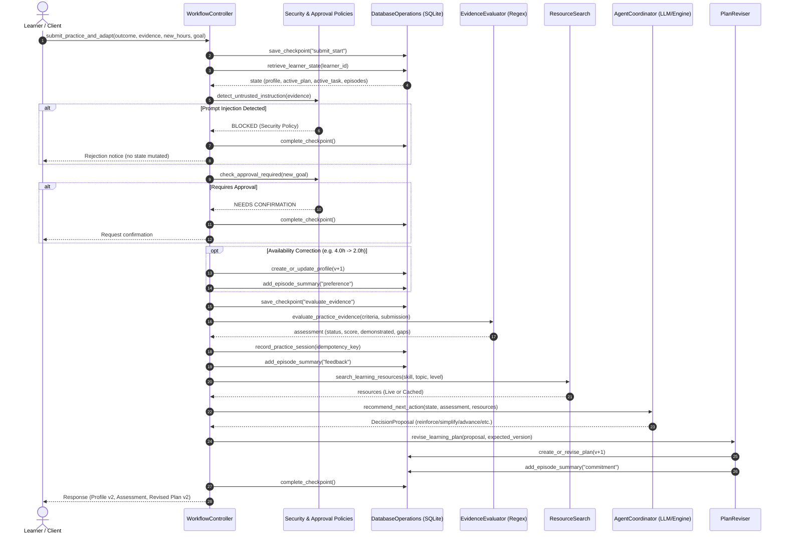

# Skill Learning Accountability Assistant (D12)

**Name: Muhammad Usman**<br>
**Roll no: 25I-7605**<br>

An autonomous, memory-augmented agentic system engineered to provide personalized accountability, deterministic evidence evaluation, adaptive planning, and auditable learning records for self-directed technical education.

---

## Table of Contents
1. [Executive Summary](#executive-summary)
2. [Problem Statement & Scope](#problem-statement--scope)
3. [System Architecture](#system-architecture)
4. [Agent Decision Loop](#agent-decision-loop)
5. [Tiered Memory Lifecycle](#tiered-memory-lifecycle)
6. [Tool Layer & Policy Guardrails](#tool-layer--policy-guardrails)
7. [Evaluation Suite & Empirical Evidence](#evaluation-suite--empirical-evidence)
8. [Implementation Decisions & Trade-offs](#implementation-decisions--trade-offs)
9. [Limitations & Future Roadmap](#limitations--future-roadmap)
10. [Installation & Getting Started](#installation--getting-started)
11. [Command-Line Interface (CLI) Reference](#command-line-interface-cli-reference)
12. [References & Citations](#references--citations)

---

## Executive Summary

Self-directed learners frequently abandon online courses and technical skill roadmaps due to miscalibrated pacing, static curricula, lack of verified accountability, and life schedule fluctuations. Traditional AI tutoring systems often rely on stateless conversational LLMs that hallucinate progress, lack provenance, destructively overwrite history, and are vulnerable to prompt injection in submitted exercises.

The **Skill Learning Accountability Assistant** resolves these failure modes by providing an auditable, stateful architecture powered by a hybrid **LLM + Deterministic Policy Engine**, an ACID-compliant **SQLite memory backend**, **cryptographic/regex evidence evaluation**, **workflow checkpoints for crash resilience**, and **strict tenant isolation**.

```
┌────────────────────────────────────────────────────────────────────────┐
│                        Workflow Controller                             │
│       (Crash Checkpoints • Event Bus • State Machine Coordinator)      │
└───────────────┬────────────────────────────────────────┬───────────────┘
                │                                        │
        ┌───────▼────────┐                       ┌───────▼────────┐
        │ Agent Engine   │                       │ Tool Ecosystem │
        │ • Groq LLM     │                       │ • Regex Eval   │
        │ • Policy Rules │                       │ • Tavily/Cache │
        │ • Pydantic Val │                       │ • Plan Reviser │
        └───────┬────────┘                       └───────┬────────┘
                │                                        │
                └───────────────────┬────────────────────┘
                                    │
                         ┌──────────▼──────────┐
                         │   SQLite Storage    │
                         │ • Profiles & Plans  │
                         │ • Checkpoints (G1)  │
                         │ • Episodes (G3)     │
                         │ • Audit Trail (G3)  │
                         └─────────────────────┘
```

---

## Problem Statement & Scope

Learners often struggle to maintain consistent practice and objectively assess their progress in self-directed study schedules. The D12 Skill Learning Accountability Assistant addresses this by maintaining a persistent history of goals, practice sessions, and obstacles to ensure that future recommendations adapt to actual learner performance. To demonstrate these capabilities, the project uses a recurring, measurable task focused on beginner Python data analysis, guiding users through steps like loading a CSV file with pandas, inspecting columns, and calculating statistical means.<br>  
The project's scope centers on building a single-agent CLI workflow backed by a persistent SQLite database, deliberately excluding complex UI or multi-agent orchestration to prioritize core functionality. To achieve its acceptance criteria, the system must successfully generate personalized plans, adapt dynamically to missed sessions or updated time constraints (while retaining historical profile versions), and identify skill gaps from partial evidence to assign targeted reinforcement. Crucially, it must also prove its ability to recover all authoritative state and historical records after a complete application restart without requiring the user to re-enter baseline information.  

---

## System Architecture

The codebase is organized into modular subsystems under `app/`:

```
app/
├── agent_coordinator.py      # Hybrid LLM (Groq) & deterministic decision engine
├── interface.py              # CLI with color-coded UX and JSON automation modes
├── prompts.py                # System prompts for coordinator & decision proposals
├── workflow_controller.py    # Main lifecycle orchestrator, checkpointing, Excel export
├── logging/
│   └── audit_log.py          # Structured event logging across memory tiers
├── memory/
│   ├── database_operations.py# High-level data access object (DAO)
│   ├── database_schema.py    # Authoritative relational DDL schema
│   ├── memory_validation.py  # Concurrency checks, isolation, profile validation
│   └── migrations.py         # Schema initialization and connection management
├── policies/
│   ├── approval_rules.py     # Prompt injection detection & goal approval gates
│   └── decision_validation.py# Pydantic schema validation for action proposals
└── tools/
    ├── evidence_evaluator.py # Deterministic regex & semantic criteria evaluator
    ├── memory_retrieval.py   # State retrieval with diagnostic isolation stubbing
    ├── plan_reviser.py       # Validated plan mutation & commitment recording
    ├── practice_recorder.py  # Idempotent session logging & obstacle tracking
    └── resource_search.py    # Tavily live search with local catalogue fallback
```

### High-Level Component Interactions



---
## Agent Decision Loop

Every learner submission triggers a deterministic 12-step transactional workflow orchestrated by `WorkflowController`:

1. **Checkpoint Inception (G1)**: Generates a persistent checkpoint record (`submit_start`) in `workflow_checkpoints` containing the incoming payload.
2. **State Hydration (G2/G3)**: Pulls the active profile, current plan, assigned task criteria, historical sessions, tracked skills, and long-term episode summaries.
3. **Security Screening (G8)**: Passes raw user text through `detect_untrusted_instruction()`. If adversarial prompts (e.g., `ignore previous instructions`, `grant admin`) are found, the submission is halted immediately and logged as a security event without executing downstream tools.
4. **Human-in-the-Loop Approval Gating (G8)**: Minor changes (weekly hours) are auto-committed; fundamental pivots (changing the primary target goal or pushing deadlines) require explicit user confirmation.
5. **Availability Recalibration (G4)**: Increments the profile version (e.g., `v1` $\to$ `v2`), preserving historical versions for longitudinal auditing.
6. **Deterministic Evidence Assessment (G7)**: Tests user evidence against specific task acceptance criteria using deterministic substring matching and keyword heuristics, extracting demonstrated competencies, missing gaps, and detecting negative failure indicators (e.g., `# could not calculate mean`).
7. **Idempotent Practice Recording (G1/G7)**: Saves the session record with a unique `idempotency_key`. Duplicate submissions (e.g., from network retries or client double-clicks) return the cached outcome without re-triggering plan revisions.
8. **Obstacle Frequency Tracking**: If a session was missed or blocked, logs an obstacle record or increments its frequency counter.
9. **Dynamic Resource Retrieval (G4)**: Queries live documentation via Tavily API with automatic failover to `data/resource_catalogue.json`. Titles are sanitized against prompt injections.
10. **Next Action Coordination**:
    * **`advance`**: Assigned when all criteria are demonstrated (score = 1.0).
    * **`reinforce`**: Assigned when evidence is partial; targets the specific missing criteria (e.g., column mean calculation).
    * **`simplify`**: Assigned when obstacles repeat (e.g., multiple missed sessions) or time budgets are reduced.
    * **`reschedule`**: Re-allocates deadlines when a single session is missed.
    * **`request clarification`**: Triggered when evidence is conflicting or empty.
11. **Optimistic Concurrency Plan Revision (G1)**: Validates proposal constraints via Pydantic (`validate_decision_proposal`), ensures task time does not exceed weekly availability, verifies the expected prior plan version, and increments the plan version.
12. **Long-Term Memory Synthesis & Checkpoint Finalization (G1/G3)**: Synthesizes high-level episodes (`preference`, `feedback`, `commitment`) and marks the active checkpoint as `completed`.

---
## Agent Decision Loop

Every learner submission triggers a deterministic 12-step transactional workflow orchestrated by `WorkflowController`:

 1. **Checkpoint Inception (G1)**: Generates a persistent checkpoint record (`submit_start`) in `workflow_checkpoints` containing the incoming payload.

 2. **State Hydration (G2/G3)**: Pulls the active profile, current plan, assigned task criteria, historical sessions, tracked skills, and long-term episode summaries.

 3. **Security Screening (G8)**: Passes raw user text through `detect_untrusted_instruction()`. If adversarial prompts (e.g., `ignore previous instructions`, `grant admin`) are found, the submission is halted immediately and logged as a security event without executing downstream tools.

 4. **Human-in-the-Loop Approval Gating (G8)**: Minor changes (weekly hours) are auto-committed; fundamental pivots (changing the primary target goal or pushing deadlines) require explicit user confirmation.

 5. **Availability Recalibration (G4)**: Increments the profile version (e.g., `v1` $\to$ `v2`), preserving historical versions for longitudinal auditing.

 6. **Deterministic Evidence Assessment (G7)**: Tests user evidence against specific task acceptance criteria using deterministic substring matching and keyword heuristics, extracting demonstrated competencies, missing gaps, and detecting negative failure indicators (e.g., `# could not calculate mean`).

 7. **Idempotent Practice Recording (G1/G7)**: Saves the session record with a unique `idempotency_key`. Duplicate submissions (e.g., from network retries or client double-clicks) return the cached outcome without re-triggering plan revisions.

 8. **Obstacle Frequency Tracking**: If a session was missed or blocked, logs an obstacle record or increments its frequency counter.

 9. **Dynamic Resource Retrieval (G4)**: Queries live documentation via Tavily API with automatic failover to `data/resource_catalogue.json`. Titles are sanitized against prompt injections.

10. **Next Action Coordination**:

    * **`advance`**: Assigned when all criteria are demonstrated (score = 1.0).

    * **`reinforce`**: Assigned when evidence is partial; targets the specific missing criteria (e.g., column mean calculation).

    * **`simplify`**: Assigned when obstacles repeat (e.g., multiple missed sessions) or time budgets are reduced.

    * **`reschedule`**: Re-allocates deadlines when a single session is missed.

    * **`request clarification`**: Triggered when evidence is conflicting or empty.

11. **Optimistic Concurrency Plan Revision (G1)**: Validates proposal constraints via Pydantic (`validate_decision_proposal`), ensures task time does not exceed weekly availability, verifies the expected prior plan version, and increments the plan version.

12. **Long-Term Memory Synthesis & Checkpoint Finalization (G1/G3)**: Synthesizes high-level episodes (`preference`, `feedback`, `commitment`) and marks the active checkpoint as `completed`.

---

## Tiered Memory Lifecycle

To prevent context bloat and separate volatile data from immutable audit logs, the system defines **four explicit memory tiers**:

| Memory Tier | Scope & Lifecycle | Persistence & Backing Tables | Role in Agent Adaptation |
| :--- | :--- | :--- | :--- |
| **1. Working State** | **Transient / Mid-Workflow**: Active session context, in-flight execution scratchpad, and crash checkpoints. | `workflow_checkpoints`<br>`tasks` (`status = 'assigned'`) | Persists step-by-step state so process restarts or crashes resume without re-executing completed side-effects. Marked `completed` upon workflow termination. |
| **2. Source Knowledge** | **External / Cached Knowledge**: Reference documentation, tutorials, and curriculum catalogs. | `resources`<br>`data/resource_catalogue.json` | Stores retrieved search results indexed by `topic` and `resource_id` with full provenance (`source`, `retrieved_at`). Grounds task recommendations with prompt-injection title sanitization. |
| **3. Operational Memory** | **Append-Only Audit Trail**: Full execution event logs, tool call traces, run IDs, and security triggers. | `event_logs` (`event_type`, `tool_name`, `outcome`) | Immutable audit trail for compliance, debugging, and inspection. Distinguishes tool outcomes (`success_live`, `fallback_cached`, `blocked_injection_attempt`). |
| **4. Long-Term Episodic Memory** | **Consolidated History**: Permanent digests of milestones, feedback, schedule adjustments, and commitments. | `episode_summaries`<br>`learner_profiles`<br>`plans`<br>`practice_sessions`<br>`skills` & `obstacles` | Retrieved in future sessions (`get_episode_summaries`, `get_learner_state`) to steer next actions, calibrate weekly workloads, and maintain commitment continuity. |

### Profile & Plan State Governance

| Governance Dimension | Mechanism | Guarantees & Policy Enforcement |
| :--- | :--- | :--- |
| **Profile Versioning** | `learner_profiles` (`version`, `is_current`) | Updates increment `version` and set prior rows to `is_current = 0`, preserving historical availability and goals for longitudinal auditing. |
| **Plan Lineage** | `plans` & `tasks` (`version`, `status = 'superseded'`) | Maintains an immutable lineage of learning contracts with optimistic concurrency checks (`expected_prior_version`). |
| **Idempotent Execution** | `practice_sessions` (`idempotency_key UNIQUE`) | Prevents duplicate side-effects or double plan revisions when network retries or repeated submissions occur. |
| **Learner Isolation** | `enforce_learner_isolation()` | Enforces strict multi-tenant boundaries; attempting to access another learner's records triggers a `MemoryValidationError`. |

## Tool Layer & Policy Guardrails

### 1. Evidence Evaluator (`app/tools/evidence_evaluator.py`)
Replaces naive string matching with compiled regex patterns that identify semantic code idioms across Pandas, NumPy, and standard library modules:
- `csv_load`: `pd.read_csv`, `read_table`, `csv.reader`.
- `inspect_columns`: `.columns`, `.head()`, `.info()`, `.describe()`, `print(df)`.
- `calculate_mean`: `.mean()`, `np.mean()`, `statistics.mean()`.
- `groupby`: `.groupby()`, `.pivot_table()`, `.agg()`.
- **Negative Pattern Filter**: Detects failure comments and exception traces (`could not`, `cannot`, `failed`, `unable to`, `error`) to prevent learners from claiming mastery via non-functional code.

### 2. External Resource Search (`app/tools/resource_search.py`)
- Interfaces with Tavily Search API.
- Implements graceful fallback to a curated offline catalogue (`data/resource_catalogue.json`).
- Resources are indexed with `learner_id` to link recommendations to user profiles.

### 3. Plan Reviser (`app/tools/plan_reviser.py`)
- Employs Pydantic's `DecisionProposal` model to ensure all required fields (`estimated_minutes`, `success_criteria`, `reason`) are present.
- Strictly bounds task duration: `0 < estimated_minutes <= (hours_per_week * 60)`.

### 4. Read-Only Excel Export (`app/workflow_controller.py`)
Generates comprehensive Excel workbooks using `openpyxl` with an authoritative warning banner:
- **Sheet 1 (`Profile History`)**: Full version progression of goals, levels, and hours.
- **Sheet 2 (`Practice Sessions`)**: Outcomes, scores, demonstrated skills, and missing gaps.
- **Sheet 3 (`Skills`)**: Current estimated mastery per skill.
- **Sheet 4 (`Episode Summaries`)**: Digest of long-term commitments and milestones.
- **Sheet 5 (`Event Log`)**: Full operational audit trail with timestamps and run IDs.

> [!IMPORTANT]
> The generated spreadsheet is an **immutable reporting view**. Direct cell modifications are intentionally not parsed back into SQLite, preserving ACID integrity against spreadsheet tampering.

---

## Evaluation Suite & Empirical Evidence

The system is rigorously verified via an automated evaluation suite (`tests/test_scenarios.py`) covering 12 target scenarios (**T01–T12**) and 3 diagnostic memory ablation comparisons (**M01–M03**).

### Evaluation Matrix

| Test ID | Evaluation Scenario | Validation Criteria | Result |
| :--- | :--- | :--- | :---: |
| **T01** | Initial Onboarding | Generates Profile v1, Plan v1, retrieves resources, logs event. | **PASS** |
| **T02** | Missed Session Adaptation | Adapts next action to `reschedule` or `simplify` after a missed session. | **PASS** |
| **T03** | Crash & Process Restart | New controller instance recovers full state from SQLite without loss. | **PASS** |
| **T04** | Approved Correction | 2.0 hrs/week correction creates Profile v2 while preserving Profile v1. | **PASS** |
| **T05** | Learner Isolation | Unauthorized cross-learner retrieval raises `MemoryValidationError`. | **PASS** |
| **T06** | Conflicting Evidence | Conflicting claims without code trigger `request clarification`. | **PASS** |
| **T07** | Idempotency & Retry | Duplicate submissions produce identical records without side-effects. | **PASS** |
| **T08** | Prompt Injection Block | Untrusted instructions (`ignore previous`) are completely blocked. | **PASS** |
| **T09** | Weak Evidence Targeting | Missing criterion (`mean`) triggers focused `reinforce` exercise. | **PASS** |
| **T10** | Repeated Obstacles | Multiple missed sessions trigger `simplify` with reduced task duration. | **PASS** |
| **T11** | Long-Term Memory | Verifies `commitment` and `preference` episodes are populated. | **PASS** |
| **T12** | Workflow Checkpoints | Checkpoints are created during execution and completed on success. | **PASS** |

### Memory Ablation Benchmark (M01–M03)

To empirically quantify the necessity of persistent state, the test suite executes an ablation harness comparing **Memory Enabled** vs. **Memory Disabled** runs:

```json
{
  "memory_comparisons": {
    "M01_missed_previous_task": {
      "memory_enabled": "reschedule",
      "memory_disabled": "request clarification"
    },
    "M02_corrected_availability": {
      "memory_enabled_hours": 2.0,
      "memory_disabled_hours": null
    },
    "M03_weak_evidence_targeting": {
      "memory_enabled_decision": "reinforce",
      "memory_disabled_decision": "request clarification"
    }
  }
}
```

- **M01**: With memory, the agent knows the learner missed session 1 and intelligently reschedules. Without memory, it has no context and can only ask for clarification.
- **M02**: With memory, the updated 2.0 hours/week constraint is preserved across process boundaries. Without memory, the time constraint is lost.
- **M03**: With memory, the agent specifically targets the unmastered `mean()` skill gap. Without memory, it cannot differentiate between novel tasks and remedial practice.

---

## Implementation Decisions & Trade-offs

1. **SQLite as the Authoritative Store**:
   - *Alternative Considered*: MongoDB or pure JSON files.
   - *Rationale*: SQLite provides zero-configuration local ACID transactions, foreign key cascades, atomic updates, and robust schema validation without running an external database daemon.
2. **Deterministic Regex Evaluator over Pure LLM Grading**:
   - *Alternative Considered*: Asking an LLM if the code satisfies the rubric.
   - *Rationale*: LLM grading introduces stochastic flakiness, latency, cost, and hallucination vulnerabilities. Regular expressions with failure pattern guards provide instant, 100% reproducible, verifiable evaluations.
3. **Hybrid Architecture (LLM + Rule Fallback)**:
   - *Alternative Considered*: Relying exclusively on Groq LLM.
   - *Rationale*: Network timeouts, rate limits, or missing API keys should never break an accountability assistant. The rule-based engine guarantees 100% uptime while preserving LLM enhancement when online.
4. **Read-Only Spreadsheet View**:
   - *Alternative Considered*: Bi-directional synchronization between Excel and database.
   - *Rationale*: Excel lacks transactional guarantees, foreign key constraints, and concurrency locking. Using Excel strictly as an export report prevents data corruption and unauthorized tampering.

---

## Limitations & Future Roadmap

- **Dynamic Sandboxing**: Currently, evidence is evaluated statically via regex and token heuristics. Integrating an isolated execution sandbox (e.g., Docker / gVisor / e2b) would allow running student code against unit tests safely.
- **Multi-Modal Submissions**: Future iterations will support screenshots of console errors, Jupyter Notebook (.ipynb) cell outputs, and audio reflections.
- **Peer & Teacher Review Gates**: Expand the human-in-the-loop gate to allow human teachers to approve plan milestones directly through a web interface.

---

## Installation & Getting Started

### Prerequisites
- Python 3.10+ (tested on Python 3.12)
- Linux / macOS / Windows WSL

### 1. Clone & Set Up Virtual Environment
```bash
git clone https://github.com/your-org/skill-learning-assistant.git
cd skill-learning-assistant

python3 -m venv .venv
source .venv/bin/activate
```

### 2. Install Dependencies
```bash
pip install -r requirements.txt
```

### 3. Environment Configuration
Create a `.env` file in the project root:
```ini
GROQ_API_KEY=your_groq_api_key_here
GROQ_MODEL=openai/gpt-oss-20b
TAVILY_API_KEY=your_tavily_api_key_here
D12_DB_PATH=outputs/d12_assistant.db
```

### 4. Run the End-to-End Demonstration Script
```bash
./run_demo.sh
```
This script executes a full multi-session learning journey: onboarding, schedule correction, process termination & recovery, partial evidence submission, Excel export, and the full test suite.

---

## Command-Line Interface (CLI) Reference

The assistant provides an interactive terminal interface with ANSI colors and optional raw `--json` output.

### 1. Onboard Learner
Initializes a new learner profile and outputs the baseline plan:
```bash
python3 -m app.interface onboard \
  --learner-id "learner_01" \
  --goal "Learn Python data analysis" \
  --level "beginner" \
  --hours 4.0 \
  --deadline "2026-11-30"
```

### 2. Submit Practice & Update Availability
Submit practice results and code evidence:
```bash
python3 -m app.interface submit \
  --learner-id "learner_01" \
  --outcome "partial" \
  --evidence "import pandas as pd; df = pd.read_csv('data.csv'); print(df.columns) # could not calculate mean" \
  --new-hours 2.0 \
  --idempotency-key "sess_001"
```

### 3. Inspect Recovered State
Inspect the learner's persistent state after process restarts:
```bash
python3 -m app.interface status --learner-id "learner_01"
```

### 4. Export Read-Only Report to Excel
Export an auditable multi-sheet spreadsheet:
```bash
python3 -m app.interface export \
  --learner-id "learner_01" \
  --output "outputs/learner_report.xlsx"
```

---

## Running the Automated Test Suite

To run all unit tests, scenarios (T01–T12), and memory diagnostic ablations:
```bash
pytest tests/test_scenarios.py -v
```

Expected output:
```
============================= test session starts ==============================
collected 4 items

tests/test_scenarios.py::test_full_d12_evaluation_suite PASSED           [ 25%]
tests/test_scenarios.py::test_excel_export PASSED                        [ 50%]
tests/test_scenarios.py::test_injection_blocks_completely PASSED         [ 75%]
tests/test_scenarios.py::test_checkpoint_resume PASSED                   [100%]

============================== 4 passed in 1.72s ===============================
```

---

## AI Usage
This project is made with the help of Gemini Argon and Claude.